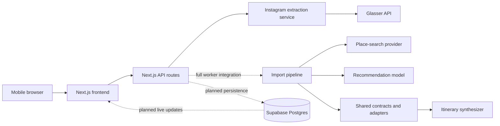

# Group Travel Planner

Group Travel Planner turns public Instagram Reels into researched trip ideas that a group can discuss and organize into an editable itinerary.

Instead of treating a Reel as a bookmark, the application extracts explicitly named places, keeps the original Reel as evidence, evaluates each place against every member's preferences, and explains why it may or may not fit the group. Members can react, flag price/distance/effort concerns, and generate a loose day-by-day plan without losing unassigned ideas.

The prototype is designed for groups of 3–8 people working with roughly 20–30 Reels.

## Product flow

1. Create a trip and add group members.
2. Record dates, pace, transport, budget, interests, and firm limits.
3. Paste a public Instagram post or Reel URL.
4. Extract explicit place candidates from permitted Reel text through Glasser.
5. Verify and research candidates using destination-aware place search.
6. Evaluate each confirmed place against every member's criteria.
7. Show a concise group recommendation with named matches and tradeoffs.
8. Collect Interested, Pass, Price, Distance, and Effort responses.
9. Group confirmed places into editable day buckets and keep overflow in Standby.

## Architecture



Solid arrows describe the currently connected Reel-import path. Dashed arrows describe components that exist in the repository but are not yet fully wired into the live application.

### Frontend

`frontend/` is a mobile-first Next.js application using the App Router, React, TypeScript, Tailwind CSS, Framer Motion, and Lucide icons. It contains:

- Trip list and trip creation screens
- Member and preference inputs
- Reel submission and processing states
- Boarding-pass-style place cards
- Reactions and structured concerns
- Confirmation and correction flows for uncertain matches
- Numeric day itinerary buckets and a Standby section

`NEXT_PUBLIC_USE_MOCK=true` runs the complete UI flow against in-memory mock data. Without that flag, the frontend calls `/api/trips/...`.

### API and backend services

`backend/` contains provider-facing services and tests. The current Next.js server routes in `frontend/src/app/api/` expose trip reads and Reel import, while the reusable backend modules implement:

- Instagram URL validation and normalization
- Glasser contract inspection, balance checks, paid runs, caching, and spend protection
- Conservative candidate extraction from allowed text
- Destination-scoped place-search orchestration
- Atomic SQLite persistence for worker records
- Shared recommendation-input construction

The remaining API routes—members, preferences, reactions, confirmation, itinerary generation, and day moves—are still represented by the frontend mock implementation and shared contracts.

### Shared domain layer

`shared/` is the provider-independent integration layer used by both frontend and backend:

- `contracts/`: stable enums, route definitions, validators, and fixtures
- `utils/instagram-import.js`: maps extraction output into imports, places, links, and evidence
- `utils/recommendation.js`: validates per-member evaluations and generates concise group copy
- `utils/itinerary.js`: deterministic planning with votes, firm exclusions, capacity, geographic grouping, and preserved manual edits
- `utils/geo.js`: Haversine distance and nearest-neighbor ordering
- `utils/trip-board.js`: Pinterest-style trip board read model
- `utils/frontend-card.js`: exact frontend `Place`, `Reel`, and `Itinerary` adapters
- `realtime/events.js`: immutable collaboration-event reducer with stale-revision protection
- `database/schema.js`: SQLite schema used by backend integration tests
- `database/supabase.sql`: proposed Postgres schema, RLS policies, and Realtime publication

The planner treats ordinary budget, distance, and effort conflicts as tradeoffs. Only explicit firm limits can block a recommendation. Uncertain places stay out of automatic plans until confirmed.

### Persistence

The intended deployed store is Supabase Postgres with Realtime. The proposed schema includes trips, members, imports, Reel contributors, places, evidence, recommendations, member evaluations, reactions, concerns, and day assignments. Row-level security restricts reads to authenticated trip members; server-side writes are expected to use protected backend credentials.

Supabase is **not deployed from this repository yet**. `shared/database/supabase.sql` is the reviewed proposal, while `supabase/schema.sql` is currently empty. The connected live route uses an in-memory trip store, and the worker integration tests use SQLite. Consequently, live imports currently disappear after a server restart and do not synchronize across devices.

## How Glasser is used

Glasser is the controlled boundary between the application and Instagram data. Provider credentials and raw responses remain on the server.

### Provider request

The extractor uses the Glasser CLI with:

| Setting | Value |
| --- | --- |
| Provider | `scrapecreators` |
| Endpoint | `/v1/instagram/post` |
| Endpoint version | `2` |
| Input | Canonical public Instagram URL |
| Additional input | `trim: false`, `include_play_count: false` |
| Timeout | 130 seconds |
| Project spend ceiling | USD 9 |

Before an uncached paid request, the service runs Glasser contract inspection and balance checks. It rejects the request when the endpoint version or pricing model has changed, the account balance is insufficient, or the projected cumulative spend would exceed the project ceiling. New paid calls require the explicit `allowPaidRun` option; cached URLs do not.

Each canonical URL receives:

- A SHA-256 cache identity
- A stable idempotency key
- A per-URL processing lock
- A private JSON cache under `backend/.data/instagram/`

Cache directories use private permissions, temporary writes are renamed atomically, and cached provider results can be reprocessed after a parser update without purchasing the same data again.

### Privacy and sanitization

The provider may return comments, but comments are not part of this product's evidence model. The backend recursively removes every comment-named field before caching or parsing the response. It does not print provider stderr because error output may contain response data.

Only these text categories can enter extraction:

- Caption text
- Provider-supplied transcript text
- Provider-supplied on-screen/OCR text

Every retained text item includes its source kind, provider-response path, and timestamp when one exists. Raw provider payloads are never sent directly to the frontend or recommendation model.

### Candidate extraction

The local parser looks for explicit place language such as:

- `📍Cala Mitjana, Menorca, Spain`
- `Place: Cala Mitjana`
- Named, structured lists in captions
- Phrases such as “visit to …” or “city of …”

It deliberately does not infer a place from scenery, hashtags, comments, music, or an unlabeled visual. Every extracted candidate begins as uncertain and keeps the exact supporting quote. A later place-search result must confirm its identity, canonical name, area, and coordinates.

The current provider responses tested by the team reliably supplied captions but not transcripts or on-screen text. The implementation does not download video, transcribe audio, or analyze frames, so a Reel that names its destination only inside the video may produce no candidate.

### Import pipeline boundary

`runInstagramImport(...)` composes Glasser extraction with shared records while keeping vendor and database choices injectable:

```text
public Reel URL
  → normalize and deduplicate
  → Glasser extraction
  → remove comments and retain traceable text evidence
  → create uncertain candidate records
  → destination-aware place search
  → confirm and research matched places
  → construct per-member recommendation inputs
  → persist successful and partial results
```

The pipeline keeps successful candidates when another candidate fails. Place-search results are treated as separate research evidence; the original caption quote only explains why the group saved the Reel.

The newest live Reel route currently calls the extraction stage directly and returns uncertain cards. Place search, model evaluation, durable persistence, and full recommendation generation exist as reusable boundaries but still need to be connected to that route.

## Recommendation model

The model boundary is intentionally narrow. For each confirmed place, the backend sends:

- Verified place fields and practical details
- Every member's interests and preferences
- Explicit firm limits
- Independently researched evidence

The model returns structured per-member fields only: `fit`, `matchedCriteria`, and `conflicts`. Shared code validates that every member appears exactly once and then produces copy such as:

> It matches Maya and Dev's interest in local food, but may be outside Sam's budget.

The frontend receives a label and concise explanation, not a numeric match percentage. Unknown facts remain unknown, and ordinary preferences never silently veto an idea.

## Itinerary synthesis

The shared planner currently:

- Includes only confirmed places in automatic day assignments
- Ranks places using group reactions
- Excludes only explicit firm-limit violations
- Groups stops by coordinates when available and area otherwise
- Respects maximum stops per day
- Preserves manual moves and removals
- Leaves overflow and unresolved ideas unassigned
- Produces a short reason for every assignment

Coordinate grouping uses straight-line Haversine distance, not live travel duration. The planner is provider-neutral so a future server-side Google Routes matrix can supply travel minutes without exposing a Google API key to the browser.

## Repository layout

```text
frontend/                     Next.js UI and current server routes
backend/                      Glasser extraction, import orchestration, persistence
shared/                       Contracts, schemas, recommendations, planning, adapters
supabase/                     Future deployed migration entry point
docs/                         Product and architecture notes
CLAUDE.md                     Detailed product and engineering constraints
```

The three-person ownership model keeps parallel work from colliding:

- Person 1 owns `frontend/` and the user experience.
- Person 2 owns `backend/`, provider calls, API behavior, and workers.
- Person 3 owns `shared/`, database contracts, recommendation output, itinerary synthesis, and project-wide documentation.

Changes that cross these boundaries should begin with an update to the shared contract, followed by the frontend and backend adapters.

## Run locally

Requirements:

- Node.js 22 or newer
- npm
- An authenticated `glasser` executable on `PATH` for uncached live imports

Run the full UI with mock data:

```bash
cd frontend
npm install
NEXT_PUBLIC_USE_MOCK=true npm run dev
```

Open [http://localhost:3000](http://localhost:3000).

Run against the implemented local API routes:

```bash
cd frontend
npm install
NEXT_PUBLIC_USE_MOCK=false npm run dev
```

Copy `.env.example` to a private `.env.local` only when configuring services. Never commit provider keys. The relevant planned variables are:

```dotenv
DATABASE_URL=
GLASSER_API_KEY=
MODEL_API_KEY=
```

The extractor also recognizes `ALLOW_PAID_GLASSER=true` in the current server route. Enable it only after reviewing the provider contract, balance, cache, and project spend ceiling.

## Tests

Run shared behavior and contract tests:

```bash
cd shared
npm test
python3 tests/schema_test.py
```

Run backend extraction and persistence tests from the repository root:

```bash
node --test backend/test/*.test.js
```

Run frontend checks:

```bash
cd frontend
npm run lint
npm run build
```

Most backend tests use fixtures or injected providers and do not purchase data. Do not enable paid Glasser runs during automated tests.

## Current implementation status

| Area | Status |
| --- | --- |
| Mobile frontend and mock workflow | Implemented |
| Caption-first Glasser extraction | Implemented |
| Extraction cache, idempotency, spend checks | Implemented |
| Place-search orchestration and SQLite persistence | Implemented and tested as reusable services |
| Shared recommendation and itinerary logic | Implemented; integration refinement continues |
| Live trip and Reel read/import routes | Partially implemented |
| Live members, preferences, reactions, and itinerary routes | Not connected |
| Supabase deployment and authentication | Not connected |
| Supabase Realtime synchronization | Not connected |
| Reel thumbnail Pinterest presentation | Planned |
| Google travel-time routing | Planned; current planner uses geographic proximity |

The prototype should not yet be presented as persistent, authenticated, or real-time. The complete mock experience is available for UI demonstrations, while the live integration currently proves the caption-to-candidate portion of the pipeline.

## Engineering principles

- Never invent place names, prices, addresses, hours, accessibility, or review consensus.
- Keep no response distinct from Pass.
- Treat concerns as discussion signals unless a member records a firm limit.
- Keep uncertain matches out of generated plans.
- Preserve the original Reel and all contributors when places merge.
- Preserve manual itinerary edits unless replacement is explicitly confirmed.
- Keep all provider and database credentials server-side.
- Validate provider, model, database, and Realtime payloads at their boundaries.

For deeper specifications, see [docs/product-scope.md](docs/product-scope.md), [docs/architecture.md](docs/architecture.md), and [shared/contracts/README.md](shared/contracts/README.md).

